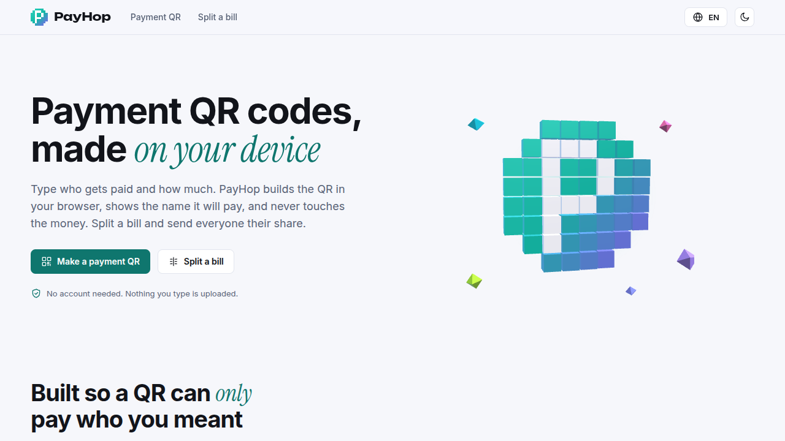

🌐 <a href="README.md">English</a> · <a href="README.zh-CN.md">简体中文</a> · <a href="README.de.md">Deutsch</a> · <a href="README.id.md">Bahasa Indonesia</a> · <b>日本語</b> · <a href="README.pt-BR.md">Português (Brasil)</a> · <a href="README.es.md">Español</a> · <a href="README.fr.md">Français</a> · <a href="README.ru.md">Русский</a>

<picture><source media="(prefers-color-scheme: dark)" srcset="docs/readme/hero-dark.png"></picture>

<h1 align="center">PayHop</h1>

<b>支払いQRコードと割り勘を、あなたの端末で。</b> PayHopは、PayPal.me、Cash App、Venmo、Solana Pay、UPI、EPC SEPAの支払いQRコードを作り、複数人で会計を割り勘にします。すべてブラウザ内で完結し、何もアップロードしません。

  <a href="https://pay.hel.ink"><b>オンラインで試す</b></a> ·
  <a href="#自分で運用する">自分で運用する</a> ·
  <a href="docs/DEPLOY.md">デプロイ</a> ·
  <a href="docs/WALLET-MATRIX.md">Wallet matrix</a> ·
  <a href="CHANGELOG.md">変更履歴</a> ·
  <a href="SECURITY.md">セキュリティ</a>

Go · Svelte 5 · 9 languages · MIT

> [!IMPORTANT]
> PayHopはお金を処理しません。入力内容からQRコードを作り、そのコードの支払い先の名前を表示し、PNGにも印刷します。すべての形式は引き続き**ウォレットでは未検証**と表示されます（[docs/WALLET-MATRIX.md](docs/WALLET-MATRIX.md)参照）。まず少額でスキャンしてください。

## できること

- 6つの形式の支払いQRを作成。受取人の名前は必須で、コードの横に表示され、PNGではコードの下に印刷されます。ダウンロード前に確認のチェックが必要です。
- 割り勘：参加者、品目、誰が分けたか、税とチップは注文額に応じて配分、端数は支払った人が負担。金額は正確な整数なので、各自の分の合計は常に総額と一致します。
- 読み込み後はオフラインで動作。9言語、ライト／ダーク、動きを減らす設定では静止ページ。
- HOP IDでのログインは動作します。支払い方法や履歴の保存は今回のリリースには含まれません。

## 自分で運用する

ブラウザアプリを内蔵した単一のGoバイナリです。ビルドとインストールの手順は[docs/DEPLOY.md](docs/DEPLOY.md)を参照。開発：`npm ci && npm test && npm run build`、続いて`go test ./...`。

<!-- hop-family:start -->
<!-- Generated from HEL.ink resources/hop-assets/apps.source.json; edit there, then run scripts/hop_assets.py build. -->
| App | Address | Repository | What it does |
| --- | --- | --- | --- |
| **HOP ID** | [hel.ink](https://hel.ink) · accounts at `hub.hel.ink` | [navi-crwn/HEL.ink](https://github.com/navi-crwn/HEL.ink) | One account for every HOP app. |
| **LinkHop** | [link.hel.ink](https://link.hel.ink) · `hel.ink/l/…` | [navi-crwn/LinkHop](https://github.com/navi-crwn/LinkHop) | Short links, QR codes and click analytics. |
| **BioHop** | [bio.hel.ink](https://bio.hel.ink) · `hel.ink/b/…` | [navi-crwn/BioHop](https://github.com/navi-crwn/BioHop) | One link-in-bio page for everything you do. |
| **PixelHop** | [pixel.hel.ink](https://pixel.hel.ink) · `p.hel.ink/…` | [navi-crwn/PixelHop](https://github.com/navi-crwn/PixelHop) | Image hosting with albums and direct links. |
| **NoteHop** | [note.hel.ink](https://note.hel.ink) · `n.hel.ink/…` | [navi-crwn/NoteHop](https://github.com/navi-crwn/NoteHop) | Encrypted notes you share with a link. |
| **FileHop** | [file.hel.ink](https://file.hel.ink) | [navi-crwn/FileHop](https://github.com/navi-crwn/FileHop) | Convert files in your browser; nothing is uploaded. |
| **Imperium** | not public-facing: optional, for admins | [navi-crwn/Imperium](https://github.com/navi-crwn/Imperium) | The HOP control panel. |
<!-- hop-family:end -->

## License

MITライセンス。[LICENSE](LICENSE)を参照。
