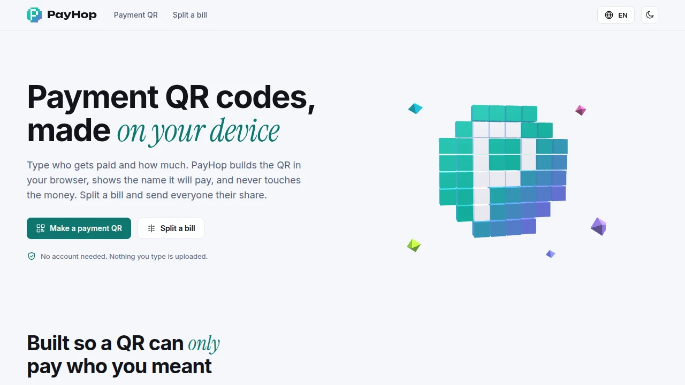

🌐 <b>English</b> · <a href="README.zh-CN.md">简体中文</a> · <a href="README.de.md">Deutsch</a> · <a href="README.id.md">Bahasa Indonesia</a> · <a href="README.ja.md">日本語</a> · <a href="README.pt-BR.md">Português (Brasil)</a> · <a href="README.es.md">Español</a> · <a href="README.fr.md">Français</a> · <a href="README.ru.md">Русский</a>

<picture><source media="(prefers-color-scheme: dark)" srcset="docs/readme/hero-dark.webp"></picture>

<h1 align="center">PayHop</h1>

<b>Payment QR codes and split bills, made on your device.</b> PayHop builds payment QR codes for PayPal.me, Cash App, Venmo, Solana Pay, UPI, EPC SEPA, PromptPay and VietQR, and splits a bill between people, all in your browser. Nothing is uploaded.

  <a href="https://pay.hel.ink"><b>Try it online</b></a> ·
  <a href="#run-your-own">Run your own</a> ·
  <a href="docs/DEPLOY.md">Deploying</a> ·
  <a href="docs/WALLET-MATRIX.md">Wallet matrix</a> ·
  <a href="CHANGELOG.md">Changelog</a> ·
  <a href="SECURITY.md">Security</a>

Go · Svelte 5 · 9 languages · MIT

  
  
  

> [!IMPORTANT]
> PayHop does not process money. It writes a QR code from what you type, shows the name that code will pay, and prints that name on the PNG. Every format is still marked **not tested in a wallet yet** (see [docs/WALLET-MATRIX.md](docs/WALLET-MATRIX.md)): scan with a small amount first.

## What it does

- Make a payment QR for eight formats. The receiver name is required, is shown next to the code and is printed under it in the PNG; you tick a confirmation before you can download.
- Split a bill: people, items, who shared each one, tax and tip spread by what each person ordered, rounding taken by the person who paid. Amounts are exact integers, so the shares always add up to the total.
- Works offline once loaded, in nine languages, light and dark, with a static page for reduced motion.
- Signing in with a HOP ID lets you save payment methods (up to 20) and your last 200 bills, one at a time and only after you tick a consent box. They are encrypted on the server (AES-256-GCM), private to your account and can be deleted at any time; guests never write anything to the server. Saving stays off until the server has a key (`PAYHOP_PROFILE_KEY`, see [docs/DEPLOY.md](docs/DEPLOY.md)).

## Run your own

One Go binary with the browser app embedded. Build and install steps are in [docs/DEPLOY.md](docs/DEPLOY.md). Development: `npm ci && npm test && npm run build`, then `go test ./...`.

<!-- hop-family:start -->
<!-- Generated from HEL.ink resources/hop-assets/apps.source.json; edit there, then run scripts/hop_assets.py build. -->
| App | Address | Repository | What it does |
| --- | --- | --- | --- |
| **HOP ID** | [hel.ink](https://hel.ink) · accounts at `hub.hel.ink` | [navi-crwn/HEL.ink](https://github.com/navi-crwn/HEL.ink) | One account for every HOP app. |
| **LinkHop** | [link.hel.ink](https://link.hel.ink) · `hel.ink/l/…` | [navi-crwn/LinkHop](https://github.com/navi-crwn/LinkHop) | Short links, QR codes and click analytics. |
| **BioHop** | [bio.hel.ink](https://bio.hel.ink) · `hel.ink/b/…` | [navi-crwn/BioHop](https://github.com/navi-crwn/BioHop) | One link-in-bio page for everything you do. |
| **PixelHop** | [pixel.hel.ink](https://pixel.hel.ink) · `p.hel.ink/…` | [navi-crwn/PixelHop](https://github.com/navi-crwn/PixelHop) | Image hosting with albums and direct links. |
| **NoteHop** | [note.hel.ink](https://note.hel.ink) · `n.hel.ink/…` | [navi-crwn/NoteHop](https://github.com/navi-crwn/NoteHop) | Encrypted notes you share with a link. |
| **FileHop** | [file.hel.ink](https://file.hel.ink) | [navi-crwn/FileHop](https://github.com/navi-crwn/FileHop) | Convert files in your browser; nothing is uploaded. |
| **PayHop** | [pay.hel.ink](https://pay.hel.ink) | [navi-crwn/PayHop](https://github.com/navi-crwn/PayHop) | Make a payment QR and split a bill; nothing leaves your browser. |
| **Imperium** | not public-facing: optional, for admins | [navi-crwn/Imperium](https://github.com/navi-crwn/Imperium) | The HOP control panel. |
<!-- hop-family:end -->

## License

MIT License. See [LICENSE](LICENSE).
